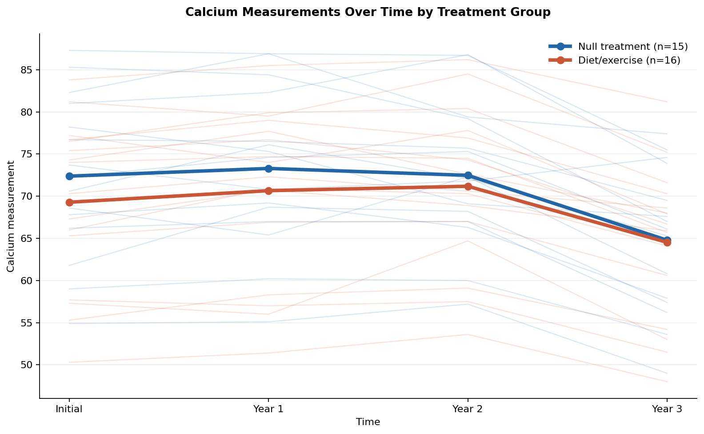

```{r}
#| label: setup
#| include: false
library(tidyverse)
library(knitr)


# Keep only diamonds whose three physical dimensions are positive.
data(diamonds)
newDiamonds <- diamonds |>
  filter(x > 0, y > 0, z > 0) |>
  select(cut, x, y, z)

# The required statistics for a vector.  Named probs arguments match
# the instructor's earlier feedback about quantile calls.
targetStats <- function(dataVector) {
  c(
    Freq. = length(dataVector),
    `0%` = unname(quantile(dataVector, probs = 0)),
    `20%` = unname(quantile(dataVector, probs = 0.20)),
    `40%` = unname(quantile(dataVector, probs = 0.40)),
    `60%` = unname(quantile(dataVector, probs = 0.60)),
    `80%` = unname(quantile(dataVector, probs = 0.80)),
    `100%` = unname(quantile(dataVector, probs = 1)),
    Med. = median(dataVector),
    Mean = mean(dataVector),
    SD = sd(dataVector)
  )
}

# This retains the basic HW #3.1 cutStats / sapply / pivot approach.
cutStats <- function(cutName) {
  cutData <- newDiamonds |>
    filter(cut == cutName)

  cutVals <- sapply(
    X = c("x", "y", "z"),
    FUN = function(x) targetStats(cutData[[x]])
  )

  as.data.frame(cutVals) |>
    mutate(stat = names(targetStats(c(1, 2, 3))), .before = 1) |>
    pivot_longer(
      cols = c("x", "y", "z"),
      names_to = "Variable",
      values_to = "value"
    ) |>
    pivot_wider(names_from = stat, values_from = value) |>
    mutate(Cut = cutName, .before = 1)
}

cutNames <- c("Fair", "Good", "Very Good", "Premium", "Ideal")
statVals <- bind_rows(sapply(cutNames, cutStats, simplify = FALSE))

# Keep five cut categories per table, rather than one 15-row table.
lengthVals <- statVals |> 
  filter(Variable == "x") |> 
  select(-Variable)
widthVals <- statVals |> 
  filter(Variable == "y") |> 
  select(-Variable)
heightVals <- statVals |> 
  filter(Variable == "z") |> 
  select(-Variable)
```
# Diamonds Table of Statistics
Tables shown in this section provide information on the physical characteristics of diamonds in terms of their cut quality. Here, `x`, `y` and `z` represent length, width and height respectively which are all expressed in millimeters. Data on zero or negative `x`, `y` and `z` values have been excluded from this analysis. The tables show the frequency of the group, percentiles (0%, 20%, 40%, 60%, 80% and 100%), median, mean and standard deviation (SD).

## Diamond Length

```{r}
#| label: tbl-diamond-length
#| tbl-cap: "Diamond length by cut quality"
#| echo: false
knitr::kable(lengthVals, digits = 3, row.names = FALSE, booktabs = TRUE)
```
@tbl-diamond-length shows how the lengths of the diamonds differ according to the cut category they fall in. For instance, the median sample length for Fair cut diamonds is 6.18 mm while that for Ideal cut diamonds is 5.25 mm. The above descriptive analysis does not necessarily indicate causation of length by cut quality.

## Diamond Width

```{r}
#| label: tbl-diamond-width
#| tbl-cap: "Diamond width by cut quality"
#| echo: false
knitr::kable(widthVals, digits = 3, row.names = FALSE, booktabs = TRUE)
```

According to @tbl-diamond-width, the median width is 6.10 mm for Fair diamonds and 5.26 mm for Ideal diamonds. From these figures, it can be seen that it is not necessary for patterns of physical sizes among different cut types to follow the same trend as a quality scale.

## Diamond Height

```{r}
#| label: tbl-diamond-height
#| tbl-cap: "Diamond height by cut quality"
#| echo: false
knitr::kable(heightVals, digits = 3, row.names = FALSE, booktabs = TRUE)
```

@tbl-diamond-height shows height. In this data set, the median height is 3.97 mm for Fair diamonds and 3.23 mm for Ideal diamonds. Heights display a distribution very similar to that seen with the other dimensions of physical appearance; however, the values and spread are to be understood in terms of heights, not in monetary or quality terms.

# Big 10 Academic Alliance
The use of the 2026 NCAA women’s basketball team-game data will be employed in this section in order to establish the association between field goal percentage and points. Each observation is based on one game per team.

```{r}
#| label: btaa-data
#| include: false
# Read the original CSV rather than adding a new Parquet dependency.
team_box_raw <- read_csv("team_box.csv", show_col_types = FALSE)

# Preserve the filter/select structure from HW #3.4.
team_box_clean <- team_box_raw |>
  filter(season == 2026) |>
  select(field_goal_pct, team_score)
```

```{r}
#| label: fig-btaa
#| echo: false
#| fig-cap: "Field goal percentage and points scored in NCAA women's basketball, 2026 season"
#| fig-alt: "Scatter plot of field goal percentage on the x-axis and team score on the y-axis for women's 2026 NCAA basketball team-game data. The general relationship between the two variables is positive."
#| fig-width: 7
#| fig-height: 4.5
# Original HW #3.4 plotting structure, labels, colors, and transparency.
ggplot(
  data = team_box_clean,
  mapping = aes(
    x = field_goal_pct,
    y = team_score
  )
) +
  geom_point(
    color = "#1E407C",
    alpha = 0.3,
    size = 1.5
  ) +
  labs(
    title = "Field Goal Percentage and Points Scored",
    subtitle = "NCAA Women's Basketball, 2026 Season",
    x = "Field Goal Percentage (%)",
    y = "Points Scored"
  ) +
  theme_bw()
```

@fig-btaa below depicts that as the field goal percentage of the team increases, the number of points scored increases. From the uploaded data, in the 2026 entries, the sample correlation between the two variables is found to be around 0.772. The scatter is not perfectly linear since scoring of points by the team depends on other variables like the number of shots attempted and free throws taken.

# Monte Carlo Numerical Integration

The Monte Carlo method for the hit-or-miss technique involves sampling points uniformly from the rectangle that contains the area under the curve, which is the non-negative function. The product of the area of the rectangle and the fraction of the points under the curve is then an approximation to the definite integral. In this case, the area under the chi-squared probability density function with five degrees of freedom and over $0 \leq x \leq 20$ is approximated using a sampling rectangle with $0 \leq y \leq 0.16$. The area of this rectangle is thus $20(0.16) = 3.2$.

```{r}
#| label: mc-setup
#| include: false
# Original HW #3.4 point generator: it already returns a data frame.
mc_simulate <- function(n, xMin, xMax, yMin, yMax) {
  x <- runif(n, min = xMin, max = xMax)
  y <- runif(n, min = yMin, max = yMax)
  points <- data.frame(x = x, y = y)
  return(points)
}

# Generalize the user's original one-resolution code to four values of n.

mc_plot <- function(n) {
  mc_points <- mc_simulate(n, 0, 20, 0, 0.16)
  mc_points <- mc_points |>
    mutate(flag = if_else(y <= dchisq(x, df = 5), "on/below", "above"))

  rectangle_area <- 20 * 0.16
  p <- mean(mc_points$flag == "on/below")
  num_int <- rectangle_area * p

  graph <- ggplot(mc_points, aes(x = x, y = y)) +
    geom_point(aes(color = flag), size = 1.0, alpha = 0.6) +
    stat_function(
      fun = dchisq,
      args = list(df = 5),
      color = "blue",
      linewidth = 1
    ) +
    scale_color_manual(
      values = c("above" = "red", "on/below" = "green")
    ) +
    labs(
      title = paste("Monte Carlo Integration, n =", n),
      subtitle = paste("Estimated Integral:", round(num_int, 4)),
      x = "x",
      y = "y",
      color = "Point Position"
    ) +
    coord_cartesian(xlim = c(0, 20), ylim = c(0, 0.16)) +
    theme_bw(base_size = 9) +
    theme(legend.position = "bottom")

  list(plot = graph, num_int = num_int)
}

# A fixed seed ensures that the calculations match repeated renders.
set.seed(184)
mc10 <- mc_plot(10)
mc100 <- mc_plot(100)
mc1000 <- mc_plot(1000)
mc10000 <- mc_plot(10000)

# The target value is the CDF difference, not identically 1.
exact_integral <- pchisq(20, df = 5) - pchisq(0, df = 5)
```

```{r}
#| label: fig-mc-multiple
#| fig-cap: "Monte Carlo Numerical Integration"
#| fig-subcap:
#|   - "10 random points"
#|   - "100 random points"
#|   - "1,000 random points"
#|   - "10,000 random points"
#| layout-ncol: 2
#| echo: false
#| fig-width: 3.3
#| fig-height: 2.5

print(mc10$plot)
print(mc100$plot)
print(mc1000$plot)
print(mc10000$plot)
```


@fig-mc-multiple illustrates how the density of sampled points increases with $n$. The estimated areas for the four panels are `r round(mc10$num_int, 4)`, `r round(mc100$num_int, 4)`, `r round(mc1000$num_int, 4)`, and `r round(mc10000$num_int, 4)`, respectively. The exact mathematical area on $[0,20]$ is `r round(exact_integral, 6)`, slightly less than 1 because the chi-square distribution has a small right-tail probability beyond 20.The greater the number of random points used, the more stable the estimate tends to be, but the estimate itself is susceptible to sampling error. The four figures below illustrate this through the estimation of the proportion of the rectangle lying below the blue line.

\clearpage

# Planning and Prompting GenAI Tools
## 4.1 Data Context and Plan
Goals:

Get, understand, and tidy the calcium dataset, and create a visualization comparing calcium measurements over time between the two treatment groups.
SG1: Have the original calcium dataset containing measurements from all 31 women in the two treatment groups.
SG2: Understand the structure of the original dataset, including its 16 rows, 8 columns, four measurement times (Initial, Year 1, Year 2, and Year 3), and missing values caused by the different group sizes.
SG3: Have a tidy dataset with 124 rows and 4 columns (Group, Woman_ID, Time, and Calcium), containing all valid calcium measurements from both groups.
SG4: Have a summary dataset with 8 rows, containing the average calcium measurement for each treatment group at each of the four time points.
SG5: Have a line graph comparing calcium measurements over time between the null treatment group and the diet/exercise group, showing both individual measurements and group averages.
SG6: Understand the main patterns in calcium measurements over time and the differences between the two groups.

Needs:
calcium.csv, RStudio, tidyverse, calcium dataset, data frame, 31 women, null treatment group (15 women), diet/exercise group (16 women), eight original columns, four measurement times (Initial, Year 1, Year 2, Year 3), calcium measurements, column names, missing values, row identifiers, Group, Woman_ID, Time, Calcium, tidy dataset, summary dataset, group averages, line graph, x-axis, y-axis, colors.

Verbs:
importing, viewing, examining, checking, identifying, counting, renaming, creating identifiers, reshaping, filtering, grouping, calculating, ordering, plotting, comparing, interpreting, and verifying.

Functions and Operators:
`library()`, `read_csv()`, `View()`, `dim()`, `names()`,
`str()`, `summary()`, `colSums()`, `is.na()`,
`mutate()`, `row_number()`, `pivot_longer()`,
`filter()`, `paste()`, `select()`, `group_by()`,
`summarise()`, `mean()`, `factor()`, `nrow()`,
`n_distinct()`, `ggplot()`, `aes()`, `geom_line()`,
`geom_point()`, `labs()`, `theme_bw()`,
`!`, `=`, `==`, `|>`, `+`.

Steps:

1. Set up the RStudio project.
A. Open RStudio and create an R script in the project.
B. Save the original calcium.csv file in the project folder without modifying it.
C. Load the tidyverse package using library().

2. Import and examine the original dataset.
A. Use read_csv() to import calcium.csv into a data frame named calcium.
B. Use View() to examine the dataset.
C. Use dim() to confirm that the dataset contains 16 rows and 8 columns.
D. Use names() and str() to examine the column names and check that the calcium measurements are numeric.
E. If any measurement columns are not numeric, investigate the problem before continuing.

3. Identify the two treatment groups and measurement times.
A. Identify the first four columns as the null treatment group with 15 women.
B. Identify the last four columns as the diet/exercise group with 16 women.
C. Confirm that each group has measurements for Initial, Year 1, Year 2, and Year 3.
D. Check how read_csv() handles the repeated column names in the original file.

4. Check for possible data issues.
A. Use summary() to examine the calcium measurements and identify any unusual values.
B. Use colSums(is.na(calcium)) to count missing values in each column.
C. Confirm that the four missing values are in the last row of the null treatment group.
D. Recognize that these missing values are expected because the null treatment group has 15 women while the diet/exercise group has 16.
E. Keep the last row because it contains valid measurements for the 16th woman in the diet/exercise group.
F. If any other missing values or unusual values are found, examine them before deciding whether they need to be corrected or excluded. Do not change valid numerical measurements.

5. Prepare the dataset for tidying.
A. Use names() to assign unique names to the eight measurement columns, identifying both treatment group and measurement time.
B. Use mutate() and row_number() to create a temporary row identifier for the original 16 rows.
C. Make sure the measurements are still associated with the correct treatment group, measurement time, and original row.

6. Create and verify the tidy dataset.
A. Use pivot_longer() to reshape the eight measurement columns into a long format, separating the treatment group and measurement time information.
B. Use mutate() and paste() to create a unique Woman_ID by combining the treatment group with the original row identifier. This prevents women from different groups from sharing the same identifier.
C. Use filter() and is.na() to exclude the four missing measurements while keeping all valid measurements.
D. Use select() to keep the four final columns: Group, Woman_ID, Time, and Calcium.
E. Use dim() to confirm that the tidy dataset has 124 rows and 4 columns.
F. Use n_distinct() to confirm that the dataset contains 31 unique women.
G. Check that the null treatment group has 60 valid measurements and the diet/exercise group has 64 valid measurements.
H. Verify that every valid measurement is associated with the correct woman, treatment group, and time point.

7. Calculate the average calcium measurements.
A. Use group_by() to group the tidy dataset by Group and Time.
B. Use summarise() and mean() to calculate the average calcium measurement for each treatment group at each time point.
C. Use nrow() to confirm that the summary dataset contains 8 rows, representing two treatment groups at four time points.
D. Check that the group averages were calculated from the correct measurements.

8. Create the calcium visualization.
A. Use factor() to order the time points as Initial, Year 1, Year 2, and Year 3.
B. Use ggplot() and aes() to create a graph with Time on the x-axis and Calcium on the y-axis.
C. Use geom_line() to show individual women's measurements over time, using Woman_ID to keep each woman's measurements connected correctly.
D. Use lighter, more transparent lines for individual measurements to reduce overplotting.
E. Add thicker lines using the summary dataset to show the average calcium measurements for the two groups.
F. Use geom_point() to show the group averages at each time point.
G. Use different colors to distinguish the null treatment group and the diet/exercise group.
H. Use labs() and theme_bw() to add clear titles, axis labels, and a readable appearance.

9. Verify and interpret the final results.
A. Confirm that the tidy dataset contains all 124 valid calcium measurements from 31 women.
B. Check that no valid numerical measurements were deleted or changed.
C. Confirm that the graph shows both treatment groups at all four time points.
D. Check that the individual lines and group average lines represent the correct measurements.
E. Compare how the average calcium measurements change over time in both groups.
F. Describe the main patterns and differences shown in the graph without assuming that the treatment caused the observed changes.

## 4.2 Plan-Informed GenAI Response
ChatGPT followed my Goals, Needs, and Steps to tidy the calcium dataset and create a visualization. It confirmed that the original dataset contained 31 women, 124 valid measurements, and four expected missing values. After tidying, the dataset had 124 rows and 4 columns, with no valid measurements removed or changed.

{#fig-calcium-plan width=90%}

@fig-calcium-plan shows the calcium measurements over time for both treatment groups. The average calcium measurements in both groups increased slightly during the early years, then decreased by Year 3. The difference between the group averages also became smaller over time.

## 4.3 Generic Prompt Response
The following graph and response were provided in the assignment. ChatGPT was given a generic prompt: "Create a data visualization for these data."

{#fig-calcium-generic width=75%}

ChatGPT's response:

"I created a visualization showing the average value of each column in your dataset."

What this shows:

- Each point represents the mean (average) of one column (y0, y1, y2, y3, etc.).
- You can quickly compare which variables tend to have higher or lower values overall.
- For example, some columns cluster around 70–73, while others drop closer to 65.

ChatGPT also suggested creating boxplots, time series plots, correlation heatmaps, or side-by-side comparisons for further analysis.

## 4.4 Comparison and Contrast
These two graphs have their representation. In particular, the first graph, which is made based on my detailed plan, represents the results in a different way, by separating the two groups of the treatment and representing the measurements of calcium of each woman, along with the changes in the average of each group through time.

At the same time, the graph, which is made based on the generic prompt, does not separate the changes in the two groups but just connects the averages of the eight original columns into one line, not taking into account the fact that these two groups are not one time series.

The detailed plan may help the graph to be closer to reality and help me to understand the connections between the variables.


# Reflection
In this class, I gained basic knowledge about R, ggplot2, Quarto, and GitHub, as well as using GitHub as an effective instrument in the learning and coding process.
Before that, I feared taking classes about coding. Moreover, considering the rapid progress of artificial intelligence technologies, I got used to solving coding issues with the help of AI. However, the use of AI is sometimes prohibited in this course. In the beginning, I found these limitations unfamiliar to me, but still had to comply with them. However, over time, I realized that there is a certain shift in my approach to dealing with coding problems. When reading a problem description, I tend to think about the goals I want to accomplish and what functions I need for this purpose.
Another problem that I have had with programming is that of being able to give a proper overview of a block of code. I tend to exclude some important facts while trying to explain what the code does. This was seen in the Code Interview exercise that our professor made us do. Instead of giving an overview of what the code is all about, I paid more attention to explaining each line of code individually. Whenever I did not understand something, I would skip it altogether.
This experience taught me that I have to figure out what the entire code is trying to achieve rather than only focusing on the functions of individual lines of code. In the coming days, I will try to develop an ability to interpret code in my own words.

# Appendix A: GenAI Usage
## Tool Information

Tool: OpenAI ChatGPT

Model: GPT-6

Date: November 19, 2026

Purpose: To tidy the calcium dataset and create a visualization based on my Goals, Needs, and Steps.

## Prompt: Original Plan
I am working on the Planning and Prompting GenAI Tools section of my STAT 184 assignment.

I have uploaded the original calcium.csv file. Please follow my Goals, Needs, and Steps below to tidy the dataset and create a visualization.

Please:
1. Examine and tidy the original dataset according to my plan.
2. Check for missing values, incorrect data types, and other possible data issues.
3. Make sure all 31 women and all 124 valid calcium measurements are included.
4. Create a graph comparing calcium measurements over time between the two treatment groups. Show individual measurements using lighter lines and group averages using thicker lines.
5. Display the final graph and briefly explain the main patterns.
6. Explain any changes you made to the data and whether you followed all the steps in my plan.
Please do not change any valid numerical measurements.

Here is my complete plan:

Goals:

Get, understand, and tidy the calcium dataset, and create a visualization comparing calcium measurements over time between the two treatment groups.

SG1: Have the original calcium dataset containing measurements from all 31 women in the two treatment groups.

SG2: Understand the structure of the original dataset, including its 16 rows, 8 columns, four measurement times (Initial, Year 1, Year 2, and Year 3), and missing values caused by the different group sizes.

SG3: Have a tidy dataset with 124 rows and 4 columns (Group, Woman_ID, Time, and Calcium), containing all valid calcium measurements from both groups.

SG4: Have a summary dataset with 8 rows, containing the average calcium measurement for each treatment group at each of the four time points.

SG5: Have a line graph comparing calcium measurements over time between the null treatment group and the diet/exercise group, showing both individual measurements and group averages.

SG6: Understand the main patterns in calcium measurements over time and the differences between the two groups.

Needs:
calcium.csv, RStudio, tidyverse, calcium dataset, data frame, 31 women, null treatment group (15 women), diet/exercise group (16 women), eight original columns, four measurement times (Initial, Year 1, Year 2, Year 3), calcium measurements, column names, missing values, row identifiers, Group, Woman_ID, Time, Calcium, tidy dataset, summary dataset, group averages, line graph, x-axis, y-axis, colors.

Verbs:
importing, viewing, examining, checking, identifying, counting, renaming, creating identifiers, reshaping, filtering, grouping, calculating, ordering, plotting, comparing, interpreting, and verifying.

Functions and Operators:
`library()`, `read_csv()`, `View()`, `dim()`, `names()`,
`str()`, `summary()`, `colSums()`, `is.na()`,
`mutate()`, `row_number()`, `pivot_longer()`,
`filter()`, `paste()`, `select()`, `group_by()`,
`summarise()`, `mean()`, `factor()`, `nrow()`,
`n_distinct()`, `ggplot()`, `aes()`, `geom_line()`,
`geom_point()`, `labs()`, `theme_bw()`,
`!`, `=`, `==`, `|>`, `+`.

Steps:

1. Set up the RStudio project.

A. Open RStudio and create an R script in the project.

B. Save the original calcium.csv file in the project folder without modifying it.

C. Load the tidyverse package using library().

2. Import and examine the original dataset.

A. Use read_csv() to import calcium.csv into a data frame named calcium.

B. Use View() to examine the dataset.

C. Use dim() to confirm that the dataset contains 16 rows and 8 columns.

D. Use names() and str() to examine the column names and check that the calcium measurements are numeric.

E. If any measurement columns are not numeric, investigate the problem before continuing.

3. Identify the two treatment groups and measurement times.

A. Identify the first four columns as the null treatment group with 15 women.

B. Identify the last four columns as the diet/exercise group with 16 women.

C. Confirm that each group has measurements for Initial, Year 1, Year 2, and Year 3.

D. Check how read_csv() handles the repeated column names in the original file.

4. Check for possible data issues.

A. Use summary() to examine the calcium measurements and identify any unusual values.

B. Use colSums(is.na(calcium)) to count missing values in each column.

C. Confirm that the four missing values are in the last row of the null treatment group.

D. Recognize that these missing values are expected because the null treatment group has 15 women while the diet/exercise group has 16.

E. Keep the last row because it contains valid measurements for the 16th woman in the diet/exercise group.

F. If any other missing values or unusual values are found, examine them before deciding whether they need to be corrected or excluded. Do not change valid numerical measurements.

5. Prepare the dataset for tidying.

A. Use names() to assign unique names to the eight measurement columns, identifying both treatment group and measurement time.

B. Use mutate() and row_number() to create a temporary row identifier for the original 16 rows.

C. Make sure the measurements are still associated with the correct treatment group, measurement time, and original row.

6. Create and verify the tidy dataset.

A. Use pivot_longer() to reshape the eight measurement columns into a long format, separating the treatment group and measurement time information.

B. Use mutate() and paste() to create a unique Woman_ID by combining the treatment group with the original row identifier. This prevents women from different groups from sharing the same identifier.

C. Use filter() and is.na() to exclude the four missing measurements while keeping all valid measurements.

D. Use select() to keep the four final columns: Group, Woman_ID, Time, and Calcium.

E. Use dim() to confirm that the tidy dataset has 124 rows and 4 columns.

F. Use n_distinct() to confirm that the dataset contains 31 unique women.

G. Check that the null treatment group has 60 valid measurements and the diet/exercise group has 64 valid measurements.

H. Verify that every valid measurement is associated with the correct woman, treatment group, and time point.

7. Calculate the average calcium measurements.

A. Use group_by() to group the tidy dataset by Group and Time.

B. Use summarise() and mean() to calculate the average calcium measurement for each treatment group at each time point.

C. Use nrow() to confirm that the summary dataset contains 8 rows, representing two treatment groups at four time points.

D. Check that the group averages were calculated from the correct measurements.

8. Create the calcium visualization.

A. Use factor() to order the time points as Initial, Year 1, Year 2, and Year 3.

B. Use ggplot() and aes() to create a graph with Time on the x-axis and Calcium on the y-axis.

C. Use geom_line() to show individual women's measurements over time, using Woman_ID to keep each woman's measurements connected correctly.

D. Use lighter, more transparent lines for individual measurements to reduce overplotting.

E. Add thicker lines using the summary dataset to show the average calcium measurements for the two groups.

F. Use geom_point() to show the group averages at each time point.

G. Use different colors to distinguish the null treatment group and the diet/exercise group.

H. Use labs() and theme_bw() to add clear titles, axis labels, and a readable appearance.

9. Verify and interpret the final results.

A. Confirm that the tidy dataset contains all 124 valid calcium measurements from 31 women.

B. Check that no valid numerical measurements were deleted or changed.

C. Confirm that the graph shows both treatment groups at all four time points.

D. Check that the individual lines and group average lines represent the correct measurements.

E. Compare how the average calcium measurements change over time in both groups.

F. Describe the main patterns and differences shown in the graph without assuming that the treatment caused the observed changes.

And calcium.csv


## Response from GPT:
1. Examination of the original calcium dataset
I examined the uploaded calcium.csv file and checked its structure, data types, missing values, and numerical measurements.
Original dataset
16 × 8
Rows × columns
Valid measurements
124
All retained
Participants
31
15 + 16 women

Data quality results
Check	Result
Original dimensions	16 rows, 8 columns
Null treatment group	15 women, 60 measurements
Diet/exercise group	16 women, 64 measurements
Measurement times	Initial, Year 1, Year 2, Year 3
Data types	All 8 measurement columns numeric
Missing values	Exactly 4
Missing-value locations	Last row, first 4 columns
Unexpected missing values	None
Invalid numerical entries	None identified
Valid measurements modified	None

The four missing values are expected because the null treatment group contains one fewer woman. The final row must be retained because it contains all four measurements for the 16th woman in the diet/exercise group.

The original CSV also repeats the column names y0, y1, y2, and y3 for both groups. These need unique names before reshaping. R's read_csv() automatically repairs duplicate names.

No additional missing values or obvious invalid entries were found. The numerical range alone does not establish whether a measurement is an outlier, so no valid observations were removed because they were unusually high or low.
2. Final calcium visualization

Thin, lighter lines represent individual women. Thick lines with points represent group averages. Blue = null treatment; orange = diet/exercise.
Download the final graph

Both groups are represented at all four time points, and each individual's measurements are connected separately.
3. Tidy dataset and group averages
The tidy dataset contains exactly 124 rows and 4 columns.
Column	Description
Group	Treatment group
Woman_ID	Unique identifier for each woman
Time	Initial, Year 1, Year 2, or Year 3
Calcium	Original numerical measurement

The summary dataset contains the following eight averages.
Time	Null treatment	Diet/exercise
Initial	72.38	69.29
Year 1	73.29	70.66
Year 2	72.47	71.18
Year 3	64.79	64.53

These means were calculated using all 15 women in the null group and all 16 women in the diet/exercise group.
4. Interpretation of the graph
Both treatment groups show similar overall patterns. Their average calcium measurements increase slightly during the early years, then decrease noticeably by Year 3.

The null treatment group begins with a higher average measurement than the diet/exercise group. However, this difference becomes smaller over time. By Year 3, the averages are very close, at approximately 64.79 and 64.53.

The individual lines show that calcium measurements vary considerably between women, even within the same treatment group.

Overall, both groups experience a decrease in average calcium measurements by Year 3, but the graph alone does not establish that either treatment caused these changes.
5. Changes made and verification
The following transformations were completed:
1. Assigned unique column names to distinguish the two groups and four measurement times.
2. Created identifiers using the treatment group and original row number.
3. Reshaped the original wide dataset into long format.
4. Removed only the four expected missing entries.
5. Preserved all 124 valid numerical measurements.
6. Created the summary dataset with eight group averages.
7. Ordered the four time points chronologically and created the visualization.
All requested data-processing and visualization steps were followed. The data were processed programmatically using the same transformation logic specified in your plan. I also prepared an R script using tidyverse functions for execution in RStudio; the graphical output displayed above was generated separately from the verified data.
6. Files
calcium_tidy.csv
124 measurements, 31 women, 4 columns
 Download

calcium_group_averages.csv
8 rows of group averages
 Download

calcium_visualization.png
Final line graph
 Download

calcium_analysis.R
RStudio script following your plan
 Download

Final verification: All 31 women and 124 valid measurements were retained, no valid numerical values were changed, and the final graph meets your requested structure.

# Appendix B: Code Appendix

```{r}
#| label: appendix-diamonds
#| eval: false

library(tidyverse)
library(knitr)

# Keep diamonds with positive physical dimensions.
data(diamonds)
newDiamonds <- diamonds |>
  filter(x > 0, y > 0, z > 0) |>
  select(cut, x, y, z)

# Calculate descriptive statistics.
targetStats <- function(dataVector) {
  c(
    Freq. = length(dataVector),
    `0%` = unname(quantile(dataVector, probs = 0)),
    `20%` = unname(quantile(dataVector, probs = 0.20)),
    `40%` = unname(quantile(dataVector, probs = 0.40)),
    `60%` = unname(quantile(dataVector, probs = 0.60)),
    `80%` = unname(quantile(dataVector, probs = 0.80)),
    `100%` = unname(quantile(dataVector, probs = 1)),
    Med. = median(dataVector),
    Mean = mean(dataVector),
    SD = sd(dataVector)
  )
}

# Calculate statistics for each cut category.
cutStats <- function(cutName) {
  cutData <- newDiamonds |>
    filter(cut == cutName)

  cutVals <- sapply(
    X = c("x", "y", "z"),
    FUN = function(x) targetStats(cutData[[x]])
  )

  as.data.frame(cutVals) |>
    mutate(stat = names(targetStats(c(1, 2, 3))), .before = 1) |>
    pivot_longer(
      cols = c("x", "y", "z"),
      names_to = "Variable",
      values_to = "value"
    ) |>
    pivot_wider(names_from = stat, values_from = value) |>
    mutate(Cut = cutName, .before = 1)
}

# Combine the five cut categories.
cutNames <- c("Fair", "Good", "Very Good", "Premium", "Ideal")
statVals <- bind_rows(sapply(cutNames, cutStats, simplify = FALSE))

# Create separate tables for length, width, and height.
lengthVals <- statVals |>
  filter(Variable == "x") |>
  select(-Variable)

widthVals <- statVals |>
  filter(Variable == "y") |>
  select(-Variable)

heightVals <- statVals |>
  filter(Variable == "z") |>
  select(-Variable)

# Display the three descriptive statistics tables.
knitr::kable(lengthVals, digits = 3,
             row.names = FALSE, booktabs = TRUE)

knitr::kable(widthVals, digits = 3,
             row.names = FALSE, booktabs = TRUE)

knitr::kable(heightVals, digits = 3,
             row.names = FALSE, booktabs = TRUE)
```

## Big 10 Academic Alliance

```{r}
#| label: appendix-btaa
#| eval: false

# Import the basketball dataset.
team_box_raw <- read_csv("team_box.csv", show_col_types = FALSE)

# Keep the 2026 season and the variables needed for the graph.
team_box_clean <- team_box_raw |>
  filter(season == 2026) |>
  select(field_goal_pct, team_score)

# Create a scatterplot of field goal percentage and points.
ggplot(
  data = team_box_clean,
  mapping = aes(
    x = field_goal_pct,
    y = team_score
  )
) +
  geom_point(
    color = "#1E407C",
    alpha = 0.3,
    size = 1.5
  ) +
  labs(
    title = "Field Goal Percentage and Points Scored",
    subtitle = "NCAA Women's Basketball, 2026 Season",
    x = "Field Goal Percentage (%)",
    y = "Points Scored"
  ) +
  theme_bw()
```

## Monte Carlo Numerical Integration

```{r}
#| label: appendix-monte-carlo
#| eval: false

# Generate random points inside a rectangle.
mc_simulate <- function(n, xMin, xMax, yMin, yMax) {
  x <- runif(n, min = xMin, max = xMax)
  y <- runif(n, min = yMin, max = yMax)
  points <- data.frame(x = x, y = y)
  return(points)
}

# Estimate the integral and create a visualization.
mc_plot <- function(n) {
  mc_points <- mc_simulate(n, 0, 20, 0, 0.16)

  # Identify points below or above the density curve.
  mc_points <- mc_points |>
    mutate(flag = if_else(
      y <= dchisq(x, df = 5),
      "on/below",
      "above"
    ))

  # Calculate the numerical integral.
  rectangle_area <- 20 * 0.16
  p <- mean(mc_points$flag == "on/below")
  num_int <- rectangle_area * p

  # Plot the sampled points and chi-square density.
  graph <- ggplot(mc_points, aes(x = x, y = y)) +
    geom_point(aes(color = flag), size = 1.0, alpha = 0.6) +
    stat_function(
      fun = dchisq,
      args = list(df = 5),
      color = "blue",
      linewidth = 1
    ) +
    scale_color_manual(
      values = c("above" = "red", "on/below" = "green")
    ) +
    labs(
      title = paste("Monte Carlo Integration, n =", n),
      subtitle = paste("Estimated Integral:", round(num_int, 4)),
      x = "x",
      y = "y",
      color = "Point Position"
    ) +
    coord_cartesian(
      xlim = c(0, 20),
      ylim = c(0, 0.16)
    ) +
    theme_bw(base_size = 9) +
    theme(legend.position = "bottom")

  list(plot = graph, num_int = num_int)
}

# Use a fixed seed to reproduce the same results.
set.seed(184)

# Run simulations with four sample sizes.
mc10 <- mc_plot(10)
mc100 <- mc_plot(100)
mc1000 <- mc_plot(1000)
mc10000 <- mc_plot(10000)

# Calculate the exact integral for comparison.
exact_integral <- pchisq(20, df = 5) - pchisq(0, df = 5)

# Display the four Monte Carlo graphs.
print(mc10$plot)
print(mc100$plot)
print(mc1000$plot)
print(mc10000$plot)
```

